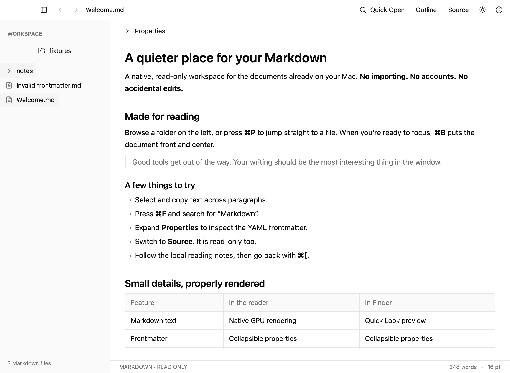
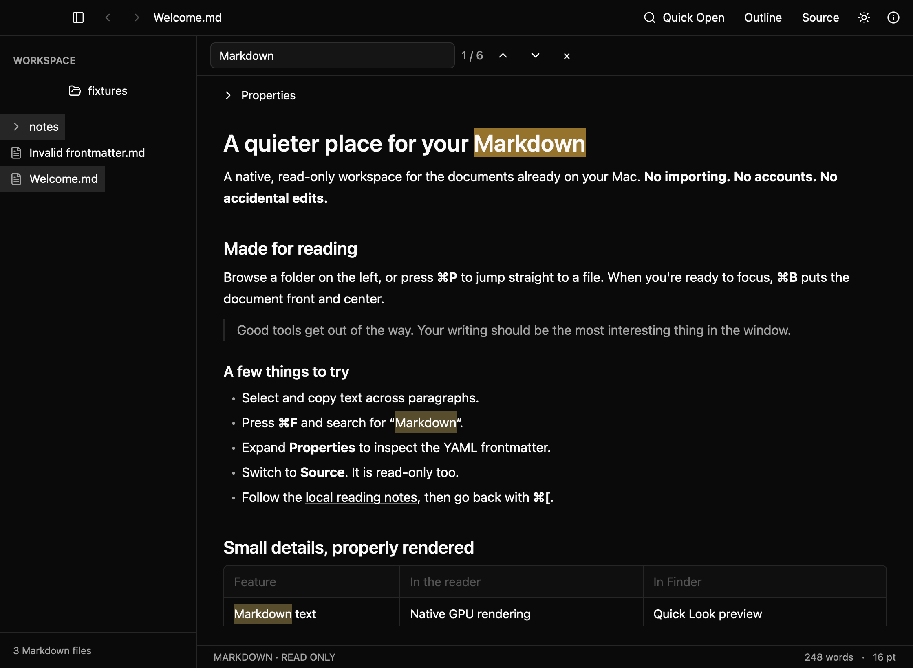

<p align="center">
  
</p>

<h1 align="center">Markdown Viewer</h1>

<p align="center">
  A fast, native, read-only Markdown reader for macOS, with a Finder Quick Look extension.
</p>

<p align="center">
  <a href="https://github.com/bryaneaton13/markdown-viewer/actions/workflows/ci.yml"></a>
  <a href="LICENSE"></a>
  
</p>

<p align="center">
  
</p>

Open a folder of Markdown, jump between files, and read them rendered. Nothing is editable, so you can't change a file by accident. It is built in Rust with [GPUI Kit](https://github.com/longbridge/gpui-kit), has no web view or Electron runtime, and works fully offline.

> **Status: early release (v0.1).** It works and is tested, but the download is ad-hoc signed, not notarized. See [Limitations](#limitations).

## Features

- Selectable, natively rendered Markdown: headings, emphasis, lists, tables, task lists, code, links, footnotes and local images.
- Folder tree and filtered **Quick Open** (⌘P) for `.md` and `.markdown` files.
- Find against the *rendered* text, with match highlighting and next/previous.
- Source view, YAML frontmatter shown in a collapsible Properties panel, and a heading outline.
- Back/forward history, light/dark mode, adjustable text size, and automatic reload when a file changes on disk.
- Finder and Dock "open with" support. Preferences persist between launches.
- **Finder Quick Look**: press Space on a Markdown file for an offline rendered preview.

<p align="center">
  
</p>

## Install

### Download (Apple Silicon)

Download the ZIP from [GitHub Releases](https://github.com/bryaneaton13/markdown-viewer/releases/latest), unzip it, and drag **Markdown Viewer.app** into Applications. The build is ad-hoc signed, not notarized, so if macOS blocks it, open **System Settings → Privacy & Security → Open Anyway**. Only approve a download you trust.

### Build from source

You need:

- macOS 13 or later (Apple Silicon or Intel)
- [Rust](https://rustup.rs). The pinned toolchain in `rust-toolchain.toml` installs automatically.
- Xcode or the Xcode Command Line Tools (`xcode-select --install`), which provide the Swift compiler used for the Quick Look extension

```sh
git clone https://github.com/bryaneaton13/markdown-viewer.git
cd markdown-viewer
scripts/bundle.sh --release --install
open "$HOME/Applications/Markdown Viewer.app"
```

This builds the app, signs it ad hoc, copies it to `~/Applications`, and registers the Quick Look extension with Finder.

### Make it your default `.md` app

Select a `.md` file in Finder, choose **Get Info → Open with → Markdown Viewer → Change All**. Repeat for `.markdown` if needed. The installer never changes your default app for you.

### Enable Quick Look

Select a Markdown file in Finder and press Space. If the preview is plain text, enable **Markdown Preview** in **System Settings → General → Login Items & Extensions → Quick Look**. Other Markdown Quick Look plugins can compete for the same file type; to check that this one is registered:

```sh
pluginkit -m -A -D -i com.bryaneaton.MarkdownViewer.Preview   # "+" means enabled
```

## Usage

```sh
cargo run -- fixtures/Welcome.md      # open a file
cargo run -- /path/to/your/notes      # open a folder
open -a "Markdown Viewer" notes.md    # after installing
```

### Keyboard shortcuts

Press ⌘/ in the app for this list and the Finder setup notes.

| Shortcut | Action |
| --- | --- |
| ⌘O / ⇧⌘O | Open file / folder |
| ⌘P | Quick Open |
| ⌘B or ⌃⌘S | Show/hide sidebar |
| ⌘1 / ⌘2 | Focus tree / document |
| ↑ ↓ ← → | Navigate the focused folder tree |
| Enter / Space in tree | Open selection / focus reader |
| ⌘F / ⌘G / ⇧⌘G | Find / next / previous match |
| ⌘[ / ⌘] | Back / forward |
| ⇧⌘M | Source / preview |
| ⇧⌘I / ⇧⌘L | Properties / heading outline |
| ⇧⌘D | Toggle light/dark |
| ⌘+ / ⌘− / ⌘0 | Text size |
| ⌘R | Reload |
| ⌃⌘F | Full screen |
| ⌘W / ⌘Q | Close window / quit |

The app keeps running after you close its window; quit with ⌘Q. Settings live in `~/Library/Application Support/Markdown Viewer/settings.json`.

## Limitations

- One document at a time: no tabs, editing, custom themes or multi-root workspaces.
- Mermaid blocks render as code. Remote images are never fetched.
- Files must be UTF-8 and at most 8 MiB.
- Folder discovery respects ignore rules, skips hidden files, does not follow directory symlinks, and stops at 20,000 files or 32 levels deep.
- Quick Look shows images as alt text (the sandbox only receives the selected file), omits raw HTML, and blocks scripts and network access.
- Not notarized: downloads need **Open Anyway** on first launch, and the Quick Look extension may need enabling by hand.

## Development

```sh
cargo test --workspace
cargo clippy --workspace --all-targets --all-features -- -D warnings
cargo fmt --all -- --check
scripts/validate.sh        # all of the above, plus bundle, Quick Look and screenshot checks
```

```text
crates/markdown-core/   parsing, frontmatter, links, find, safe HTML, Quick Look C ABI
crates/app/             GPUI application, reader, folder discovery, preferences
native/QuickLook/       Swift Quick Look preview provider and bridge smoke test
assets/                 Info.plist, app icon, logo
fixtures/               sample Markdown and a local image for tests and screenshots
scripts/                bundle/install, packaging, screenshots, validation
docs/                   original research and design plan
```

`scripts/shot.sh OUT.png FILE STATES` captures the real GPUI window with Metal `render_to_image`, with no screen-recording permission needed. `STATES` is a comma-separated list of `light`, `dark`, `browse` (open the file's parent folder in the sidebar), `nosidebar`, `properties`, `source`, `outline`, `quick-open`, `find:query`, `help`. Set `MARKDOWN_VIEWER_STATE_DIR=/path/to/scratch` to keep experiments away from your real settings.

`scripts/check-quicklook.sh` compiles and calls the same Swift-to-Rust bridge the extension uses and writes `reports/quicklook.html`. It checks rendering, not Finder's choice of preview provider, so test that with an installed bundle.

## Contributing

Issues and pull requests are welcome. Before opening a PR, run `scripts/validate.sh` (CI runs the same checks) and add a test for behavior changes. Background and design intent are in [docs/RESEARCH.md](docs/RESEARCH.md) and [docs/PLAN.md](docs/PLAN.md).

Changes are listed in [CHANGELOG.md](CHANGELOG.md).

## License

[MIT](LICENSE). Built on [GPUI Kit](https://github.com/longbridge/gpui-kit) (Apache-2.0).
