# Mermaid diagrams

Fenced `mermaid` blocks are drawn as diagrams in the reader's theme. Hover a diagram for **Copy** and **Code**. A block that can't be drawn stays as code.

## Project lifecycle

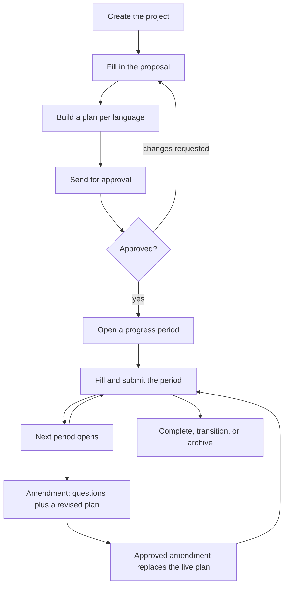

## How a document is read

A wide left-to-right chart shrinks to fit the page, then scrolls sideways.

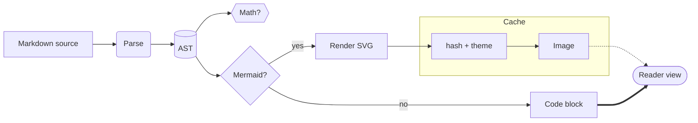

## Sequence

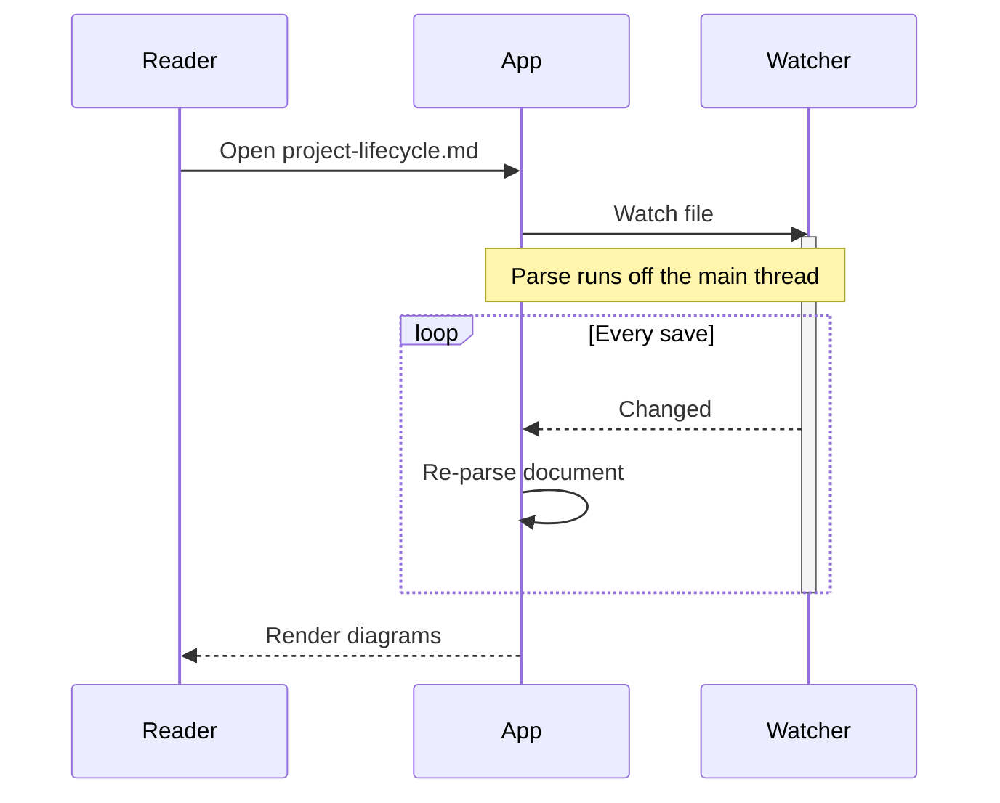

## State

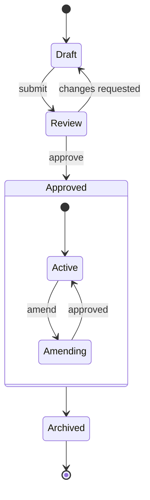

## Class

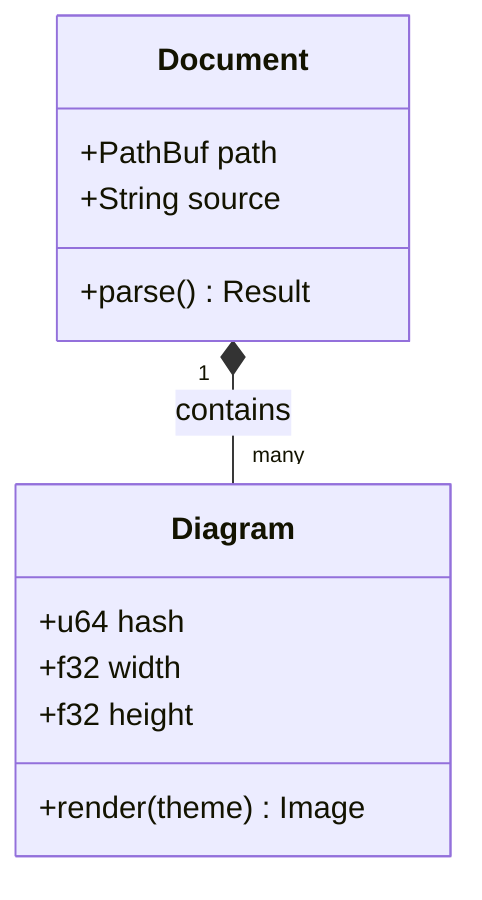

## Entity relationship

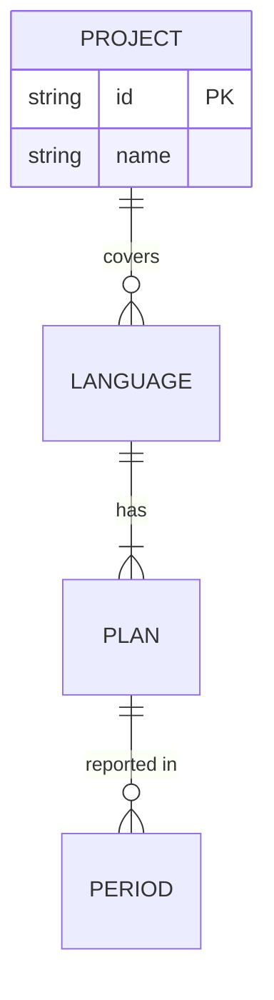

## Gantt

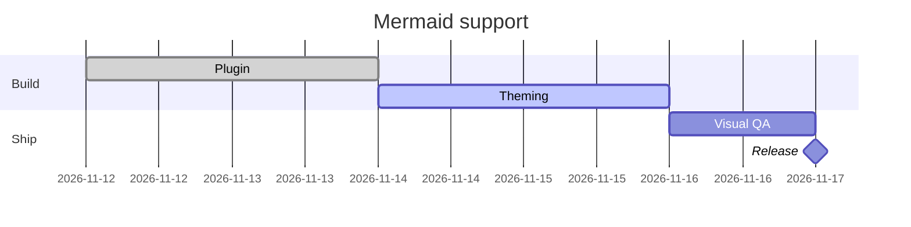

## Pie

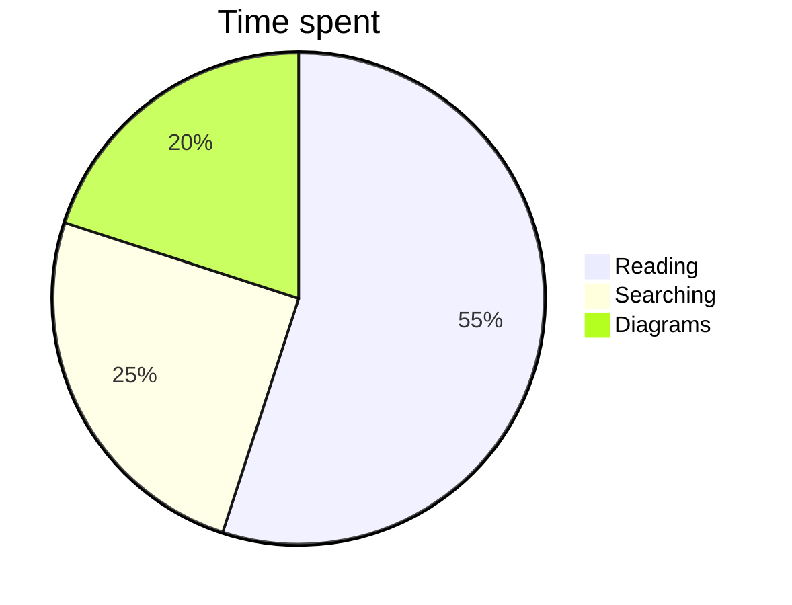

## Mind map

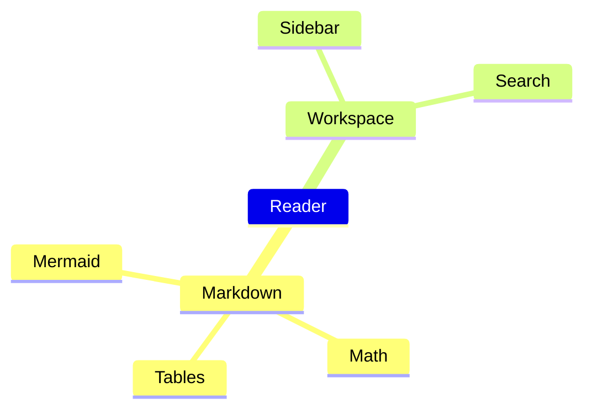

## Git graph

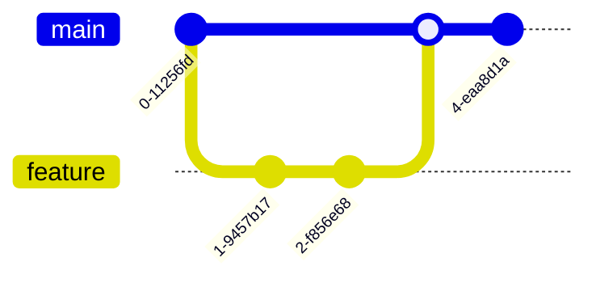

## Stays as code

A diagram with a syntax error:

```mermaid
flowchart TD
  a[Start] -->|label b
```

A diagram with nothing in it:

```mermaid
sequenceDiagram
  A->>
```

A diagram type the renderer doesn't know:

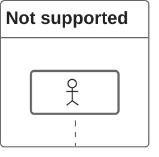
