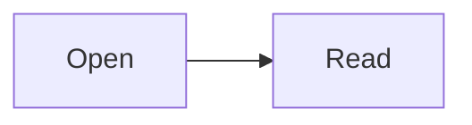

# Reading notes

This is a second file to exercise relative links, folder navigation and history.

## Back to the workspace

[Return to the welcome document](../Welcome.md)

### Code stays code

Mermaid is intentionally displayed as a code block in this prototype.

## Unicode

Café, 日本語, naïve, résumé. Search should highlight the original UTF-8 text correctly.
